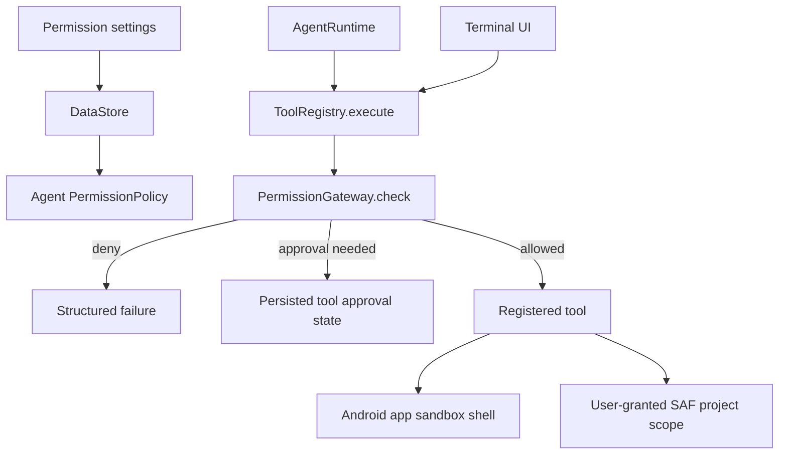

# COSMIC Agent Runtime — M4 foundation status

This document records the first M4 implementation slice. It does **not** claim a complete CAR, Linux environment, package manager, approval system, or public preview service.

## Implemented in this slice

- Local agent tools now enter through `ToolRegistry.execute()`, which classifies the operation and asks the shared `PermissionGateway` immediately before dispatch.
- Permission classes cover file reads, writes, command/Git execution, and network search. Per-operation policy is passed to the gateway without mutating the gateway's stored default policy.
- The Terminal screen no longer calls the shell process method directly. It uses the same registry and reads its terminal/approval flags from DataStore-backed preferences.
- Settings permission switches now read and persist DataStore values. The application combines those values into the active agent `PermissionPolicy`.
- The shell process method is private to `RunCommandTool`.
- Unit tests were added for network denial, non-mutating policy overrides, and destructive command approval.

## Current execution boundary

`PermissionGateway` decision history is currently an in-memory ring buffer. Task/tool execution outcomes are persisted separately by the existing Room task ledger; this is not yet a durable permission audit log.

## Verified Android runtime capability snapshot

Device: itel S665L, Android 12/API 31, `arm64-v8a`. A read-only `command -v` check found `/system/bin/sh`; it did not find Python, Node/npm/pnpm/yarn, Java/Javac, Gradle, Cargo, Go, Clang, or CMake. COSMIC therefore cannot currently claim local Python/Node/Rust/Go/C/C++ project builds or package installation on this device. No isolated Linux userspace or package cache is installed.

The existing shell runs under the COSMIC Android app UID and Android sandbox. It is not a container or desktop Linux environment. The app has the INTERNET permission; this slice does not provide process-level network egress isolation. A public preview URL also requires a configured, approved remote tunnel/deployment service, which is absent.

## Incomplete / required next M4 work

- The user approval lifecycle is implemented for Agent tools, Terminal, and MCP tools surfaced to the model: requests persist, Security Center and Agent UI expose decisions, approval is task/call/hash/expiry scoped, and approved requests require an explicit Continue after restart if execution was not claimed.
- MCP model tool IDs are namespaced to avoid collisions. MCP execution passes through the shared PermissionGateway; an MCP operation that requires approval is persisted and resumed through the same Room approval lifecycle. Direct low-level `callTool()` remains fail-closed when approval is required because it has no task context.
- Durable approval and execution audit events are stored in Room, and all current event producers route through `SecurityAuditRepository`.
- The v3→v4 Room migration adds audit sequence/hash fields and retains old event rows; legacy rows are deterministically sealed on first verification/write.
- Stronger command-risk analysis and process cancellation/resource limits.
- Runtime isolation and resource quotas.
- Actual compatible Python/Node runtimes and package managers, or an explicitly configured remote execution adapter. None are installed or implemented here.
- Package integrity/cache/lockfile management.
- Server lifecycle, health checks, browser preview, tunnel/deployment integrations, and public HTTPS URLs.
- Integration tests for permission grant/denial/revocation, settings-to-runtime policy propagation, and execution recovery.

## Verification status

The existing GitHub Actions success for commit `bb736c50a95baa83e4b4b1c030685cca468ba809` predates this M4 change and does not verify it. The local Android build is blocked because this Termux environment has no Android SDK (`SDK location not found`). Do not treat the new source or tests as compiled or passed until CI or a local Android SDK build runs against this working tree.

## M4 approval and audit slice (unverified build)

Implemented in the current working tree:

- Room schema version 4 includes `approval_requests`, `security_audit_events`, and hash-chain columns. Migrations 1→2, 2→3, and 3→4 are declared; historical v1/v2 schemas remain in the repository.
- Agent tool requests that return `NeedsApproval` are persisted atomically with the tool ledger state and task transition to `AWAITING_APPROVAL`.
- Approval requests have stable IDs, task/call/tool/action/resource/risk/reason fields, argument hashes, expiry, decision mode, and status. They do not duplicate tool arguments into the approval or audit tables.
- The Agent screen displays persisted pending/approved requests after navigation or process recreation. It shows the exact stored command or file operation before decision, and offers Allow Once, task-scoped Allow for identical `write_file` arguments, Deny, Cancel, and explicit Continue for an already-approved operation that had not yet started before process death.
- Terminal approvals now use the same Room request/decision/execution lifecycle via a synthetic persisted task; allow/deny/cancel survives leaving the Terminal screen and application restart. A command is shown as pending until explicit approval.
- A decision is checked against the persisted task, tool, call ID, exact argument hash, approval expiry, and task state. Denial cancels the task. Execution is atomically claimed once. A process interruption during an approved external operation becomes `UNKNOWN`, is audited, and is not replayed.
- Tool execution requests, claims, outcomes, process-interruption outcomes, and approval lifecycle events are retained in Room. The Security Center provides searchable and decision-filtered views plus pending approval actions and a live chain-integrity check.
- Terminal permission prompts are explicit and durable. Agent-dispatched MCP calls use the same persisted approval and resume workflow; a low-level direct MCP API call without task/request identity remains fail-closed on `NeedsApproval`.
- Task-scoped reuse is deliberately restricted to byte-identical `write_file` arguments for the same task. Commands and other potentially non-idempotent actions require a new approval.

Important verification status:

- `git diff --check`: passed after the edits to this slice.
- `./gradlew :app:testDebugUnitTest :app:lintDebug :app:assembleDebug --no-daemon`: NOT RUN TO COMPLETION; Gradle stopped during task configuration because no Android SDK is installed/configured (`ANDROID_HOME` and `ANDROID_SDK_ROOT` are unset; no `local.properties`). Kotlin compilation, Room schema generation/migration verification, tests, lint, APK assembly, install, and device interaction are therefore UNVERIFIED.
- Schema v3 export is not committed as a generated artifact: KSP could not run without an SDK. Do not treat the hand-written migration SQL as a generated schema verification.
- Audit storage is persistent but not cryptographically tamper-evident. Android private database protection is relied on; no tamper-proof claim is made.
- The existing tool ledger still persists tool arguments/results to recover model context. The new audit tables avoid copying full arguments or file contents, but existing tool-ledger data minimization/encryption needs a separate design review.
- `ALLOW_FOR_TASK` is implemented only for exact-argument `write_file` reuse within the originating task; other tool types do not get broad task grants. MCP approval requests are recorded as blocked at the gateway rather than presented as actionable approvals.

## Audit integrity and latest verification (working tree)

- Audit events have a monotonically increasing sequence, previous-event hash, and SHA-256 event hash over length-prefixed canonical fields. New writes verify the existing chain within the same Room transaction and fail closed on detected tampering. Historical unchained rows are sealed deterministically by timestamp/event ID on first verification. This is tamper-evident against partial row edits/deletions, not tamper-proof against an attacker able to rewrite the full app-private database.
- The app now initializes the shared PermissionGateway before constructing the MCP manager. Startup runs audit verification and approval recovery; errors are logged without credentials or event content.
- A v3 fixture test and chain-tampering/redaction tests were added but have **not run**. Generated Room v4 schema is not available because KSP could not configure without Android SDK.
- Latest attempted command: `./gradlew :app:compileDebugKotlin :app:kspDebugKotlin :app:testDebugUnitTest :app:compileDebugAndroidTestKotlin :app:lintDebug :app:assembleDebug --no-daemon` — **FAILED before task execution**, exit 1, `SDK location not found`; compilation, KSP, tests, lint, APK assembly, install and runtime are unverified.
- `git diff --check` passed after the current edits. No commit was created.
